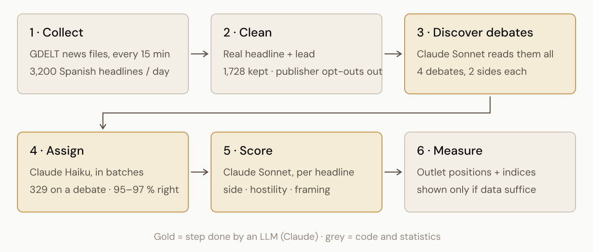
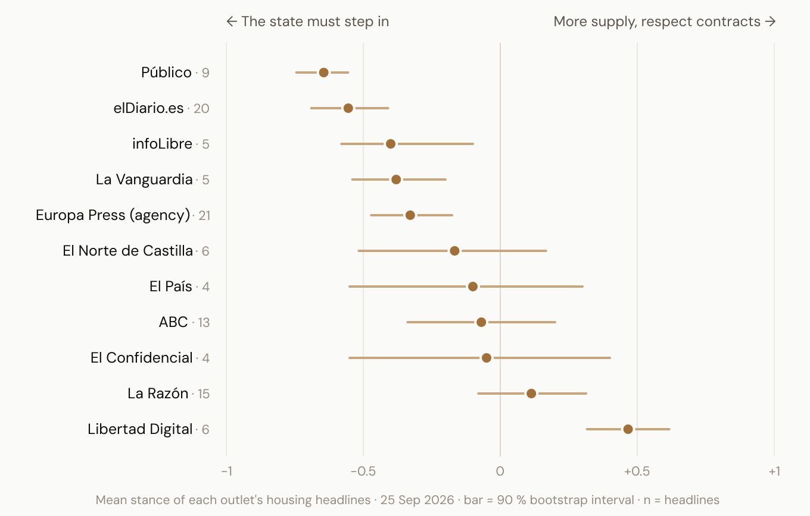
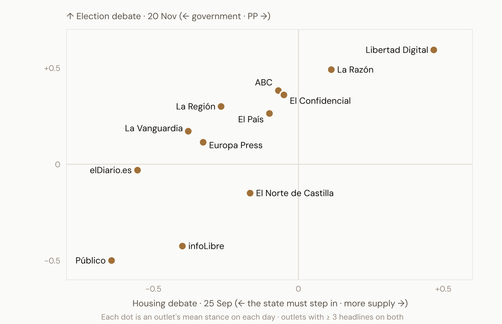

# PolarMap

**An AI pipeline that reads a country's daily news, discovers what is being argued about, and measures how divided the press is on each debate.**

Every day the Spanish press publishes a few thousand headlines. PolarMap reads all of them, finds the debates of the day without a predefined topic list, works out the two sides of each debate, and places every headline and every outlet between those two sides. From there it measures two kinds of polarization: *ideological* (are outlets split into camps?) and *affective* (do they use hostile language against the other camp?).

> Status: working prototype on Spain. The pipeline runs end to end; the evaluation below says which parts are reliable today and which are not.
> Portfolio write-up: [luciagarciamorenog.netlify.app/polarmap](https://luciagarciamorenog.netlify.app/polarmap)



---

## The headline result

On 25 September 2026 the system found four debates in the Spanish press: housing and evictions, migration, judicial independence, and AI regulation. For housing it defined the two sides as *"the state must step in"* (anti-eviction decrees, limits on investment funds) versus *"more supply and respect for contracts"*.

The chart shows where each outlet's housing headlines sit on that axis:



- **The outlet a headline comes from explains about a third of its stance** (η² = 0.33, versus ≈ 0.1 when stances are shuffled at random; permutation p < 0.01).
- **The order matches what any reader of the Spanish press would expect**, from Público and elDiario.es on one side to Libertad Digital on the other, even though the model was never told anything about the outlets.
- The same story produced headlines on both sides. One side ran *"Las cinco medidas que propone el Sindicato de Inquilinas en su 'decreto Maricarmen'"*; the other ran *"Los falsos amigos de Maricarmen"*. This is exactly the kind of split PolarMap is built to detect.

### Does it replicate? Two months later, a different debate

On 20 November 2026 the system ran again and found a different main debate: the televised face-to-face between Pedro Sánchez and Alberto Núñez Feijóo held the night before, ahead of the 29 November general election (243 headlines, 24 outlets). The model built that axis from scratch, with no memory of September. Outlets were again clearly positioned (outlet explains 27 % of stance variance, permutation p < 0.001).

Then the real test: do outlets sit in the same place on two unrelated debates, two months apart?



**Yes: Spearman ρ = 0.89 across the 12 outlets present on both days (p < 0.001).** Each debate's axis is generated independently, so this consistency cannot come from a shared prompt or a fixed left–right label. It is the strongest evidence so far that per-outlet stance measures something real.

On thinner debates (fewer than ~80 headlines) the outlet signal is still not distinguishable from chance on a single day. That is the next thing to fix (see [Roadmap](#roadmap)).

---

## Is the press split into camps? Measuring outlets, not headlines

A single headline mostly informs: even partisan outlets publish wire copy, quotes from both sides and plain data. On both runs the outlet explains only about 30 % of a headline's stance; the rest varies within each outlet. So the per-headline index answers *"how much does the press editorialise?"*, not *"are outlets split into camps?"*. `analysis/ecosystem.py` answers the second question directly (no API calls):

- **One outlet, one vote.** Every outlet weighs the same, however many headlines it publishes.
- **Camps of outlets.** The best two-way split of outlet positions, the distance between the two camps on the −1…+1 scale, and how much distance chance alone would produce (stances shuffled across the same outlets). Only the excess over chance is editorial separation.
- **Agenda polarization.** Whether outlets choose to cover different debates (Jensen–Shannon distance between their agendas vs. chance).
- **Opinion vs. news**, from the URL, and whether the most extreme outlets are also the most hostile.
- **A fixed government ↔ opposition axis** (`bloc`, codebook v3), the same for every debate and day. Issue axes deliberately ignore which party a headline hurts; in Spain much of the split is partisan, and without this axis it was invisible.

| Run | Debate | Per headline | One outlet, one vote | Outlet explains | Distance between outlet camps (chance) |
|---|---|---|---|---|---|
| 20 Nov | Election debate (24 outlets) | 0.31 | 0.36 | 27 % (chance 10 %) | **0.58 (0.38), p = 0.04** |
| 25 Sep | Housing (15 outlets) | 0.23 | 0.24 | 33 % (chance 12 %) | 0.52 (0.41), p = 0.11 |
| 25 Sep | Judiciary (10 outlets) | 0.48 | 0.44 | 9 % (chance 19 %) | 0.28 (0.42), n.s. |

- On the election debate the outlets form two camps clearly beyond chance, and the outlets at the extremes are the most hostile (ρ = 0.55 between extremity and hostility).
- On the judiciary axis ("judges are legitimate" vs. "lawfare"), Público and Libertad Digital land on the same side: the issue axis cuts across the partisan divide. This is the case the government ↔ opposition axis is for.
- Agendas differ beyond chance on both days (Jensen–Shannon 0.33 vs. 0.26 and 0.29 vs. 0.22): outlets disagree as much in what they cover as in how.
- Grouping by BIC still finds one cluster of outlets, not two: with one day of data, outlets look like a spectrum rather than two blocs.

```bash
python3 validate/ecosystem_report.py data/internal/<run>_headlines.jsonl
```

## Social layer (Bluesky and YouTube)

`pipeline_social.py` runs after a press run and reuses its debates, poles and 24-hour window, so press and social media are measured with the same ruler:

- **Official political communication:** press releases from the Government (La Moncloa) and the parties, read from their RSS feeds (found automatically on each site). Government and parties are treated as senders, like outlets: how hostile their language is, how often they frame "us vs. them", where they stand on each debate and which debates they push compared with the press. Government and opposition are measured together so the layer is not aimed at one side. Source for La Moncloa: "Origen de los datos: sitio web de lamoncloa.gob.es. Ministerio de la Presidencia."
- **Bluesky accounts:** what parties, politicians, journalists, outlets and government institutions post (public API, no key).
- **Bluesky replies:** how the public answers them. Authors are pseudonymised (salted hash) and only used in aggregate.
- **YouTube comments** on videos from outlets and parties (free YouTube Data API key).

The report compares, per debate and layer: the polarization index, mean |stance|, share at the centre, hostility, "us vs. them" framing and the government ↔ opposition axis, plus how each layer leans. Bluesky's Spanish user base leans left, so the report also shows which groups of listed accounts actually posted; a layer missing one side is reported as such, not compared as if it were balanced.

```bash
python3 pipeline_social.py --check                         # verify the account and channel list (free)
python3 pipeline_social.py --press-run snapshot_ES_<date>  # ~1.5-2.5 $ per run
./semanal.sh                                               # weekly: press + social
```

## How it works

| Step | What happens | Where |
|---|---|---|
| 1. Collect | Downloads [GDELT](https://www.gdeltproject.org/) Global Knowledge Graph files (main + translated series, every 15 min) and keeps articles from the country's media domains | `ingest/gkg_files.py` |
| 2. Clean | Drops articles without a headline, soft sections (sport, horoscopes…) and syndicated copies; reads the real headline and lead of each article; **skips publishers that reserve text-and-data-mining rights** | `analysis/discover.py`, `ingest/leads.py` |
| 3. Discover debates | Claude Sonnet reads all the day's headlines and proposes the debates, each with two poles | `analysis/discover.py` |
| 4. Assign | Claude Haiku assigns every headline to one debate or to none (Batch API, half price) | `analysis/discover.py` |
| 5. Score | Claude Sonnet scores each on-debate headline following a written [codebook](validate/CODEBOOK.md): stance including framing (−1 … +1), hostility of the language (0–2), conflict, "us vs them" | `analysis/discover.py` |
| 6. Measure | Polarization indices per debate (Esteban-Ray, affective index, composite) and outlet positions with bootstrap intervals; a debate is only shown if it has enough headlines, outlets and source diversity | `analysis/metrics.py`, `analysis/outlets.py`, `analysis/contract.py` |

The output is a compact JSON snapshot defined by a frozen [data contract](CONTRACT.md) for a future map front end. Debate axes are stored in a registry so that the same debate keeps the same orientation across runs.

## Design decisions

1. **Stance, not sentiment.** A headline about an earthquake is very negative and not divisive at all. Sentiment measures tone; PolarMap measures *which side* a headline takes on a defined axis.
2. **Disagreement is not polarization.** Opinions spread evenly across a scale are diverse, not polarized. Polarization means clustering into separate camps. That is why the index is Esteban-Ray (rewards separated groups) and not variance.
3. **Ideological ≠ affective.** Two camps that disagree politely are different from two camps that attack each other. The two are measured separately and combined with a geometric mean, so the composite drops if either is near zero.
4. **Debates are discovered, not predefined.** The system decides what is being argued about in each country each day, instead of searching for a fixed list of topics.
5. **Grey beats a wrong colour.** A debate only gets a number if it has ≥ 80 on-topic headlines, ≥ 8 outlets and no outlet above 40 % of the volume (Kish effective sample size and HHI concentration checks). Otherwise it is reported as insufficient data.
6. **Validate before believing.** Every model-produced field is checked against human labels or a reference set before it is used (below).

## Evaluation

Label-based figures are from the 25 September 2026 run on Spain (1,728 headlines); the replication uses the 20 November 2026 run (2,091 headlines).

| What the model does | Result | Verdict |
|---|---|---|
| Assign a headline to the right debate (or none) | **97 % agreement, κ = 0.95** vs 29 human-labelled headlines · **95 %, κ = 0.93** vs a 150-headline reference set | Reliable |
| Hostility of the language | Spearman ρ = 0.62 (human) · 0.63 (reference) | Usable |
| Stance of a *single* headline | ρ = 0.33 (human, n = 12) · 0.46 (reference, n = 68); the model puts 32–42 % of headlines at the centre vs 12–17 % for human labels | **Weak** |
| Stance of an *outlet* (mean of its headlines) | Outlet explains 27–33 % of stance variance on the main debate of each day (p < 0.01); outlet order replicates across two debates two months apart (ρ = 0.89) | Consistent |

The reference set was labelled by a stronger model following the same codebook, so it is not independent of the model being evaluated; the human set is small. Both limits are stated on purpose.

**Cost.** One full run for Spain costs **$0.43–0.56** (Claude Sonnet 4.6 + Haiku 4.5 through the Batch API), i.e. **$0.25–0.27 per 1,000 headlines**. Measured from real token usage on both runs, not estimated (`data/internal/*_usage.json`).

**Context worth knowing:** 81 % of the day's headlines belong to no debate at all (events, services, sport, data). Most news is not a fight.

## What did not work (yet)

- **Per-headline stance is noisy**, and it pulls ambiguous headlines towards the centre. This is why the analysis is moving from single headlines to outlets.
- **Two methods disagree.** The main index gives Spanish debates moderate ideological polarization (0.25–0.57). A second method tested in a pilot (comparative judgements → Bradley-Terry → groups by BIC, in `validate/pilot/`) finds a single group in all four debates on the same day. Neither is conclusive yet, so no country-level polarization score is published; the outlet positions are.
- **The bimodality test does not fit the scale.** Hartigan's dip test assumes continuous data; on a five-point stance scale it returns "significant" almost always. It is being replaced by group detection on outlet positions.

## Roadmap

1. Run Spain daily for a week so smaller debates also reach enough headlines per outlet (stability across days: first check passed, ρ = 0.89).
2. ~~Compute polarization between outlets~~ Done (22 Nov): camps of outlets vs. chance, one outlet one vote, agenda, opinion, government ↔ opposition axis. Next: the same measures over a week of runs.
3. Expand the human-labelled set to 100+ headlines, with a second annotator to measure the human ceiling.
4. Extend to the 10 countries in the data contract and validate against [V-Dem](https://www.v-dem.net/) (`validate/ground_truth.py`).
5. Public map, then an agent that answers questions like *"what does each side argue about housing?"* with cited headlines.

## Run it

```bash
pip install -r requirements.txt
cp .env.example .env            # add your Anthropic API key

# tests (no network, no API key)
cd analysis && python3 test_metrics.py && python3 test_outlets.py && cd ..

# count headlines for Spain without calling the API
python3 pipeline_discover.py --countries ES --hours 24 --dry-run

# full run: reads every GDELT file (about twice the headlines of the
# earlier runs, which used --every 2); roughly 40-60 min and ~$1
python3 pipeline_discover.py --countries ES --hours 24 --out snapshot_ES.json

# outlet positions and the media-ecosystem report for a run (no API)
python3 validate/outlet_positions.py data/internal/snapshot_ES_headlines.jsonl
python3 validate/ecosystem_report.py data/internal/snapshot_ES_headlines.jsonl

# more precise stance: every headline read 3 times and averaged (stance step x3)
python3 pipeline_discover.py --countries ES --hours 24 --stance-passes 3 --out snapshot_ES.json
```

## Repository map

```
ingest/      GDELT files, real headlines and leads
analysis/    debate discovery, scoring, polarization metrics, outlet positions, media ecosystem, data contract
validate/    codebook, labelling tool, scoring against labels, pilot of the second method
data/        snapshots, debate-axis registry, labels (press excerpts are not redistributed)
docs/        figures and the original methodology notes (Spanish)
```

## How it was built

I designed the product and the methodology: what to measure, how to measure it, which checks a number has to pass before it is shown, and how to validate it. The code was written with AI coding assistants (Claude and Cursor), with me reviewing, running and testing every step. The project is as much about using AI to *build* as about using AI to *measure*.

## Data and ethics

- Source: the open [GDELT Project](https://www.gdeltproject.org/).
- Coverage: an outlet counts as Spanish if its domain ends in .es, .cat, .eus or .gal (so the Catalan, Basque and Galician-language press is included since 22 Nov) or it is on an explicit list of Spanish .com outlets in `ingest/gkg_files.py`. Outlets whose URLs carry no readable headline (El Mundo, RTVE, La Voz de Galicia) are now kept and read from the page; before 22 Nov they were dropped entirely. Coverage per outlet still depends on what GDELT collects. The two runs published here (25 Sep, 20 Nov) predate these changes and sampled every other GDELT file.
- Publishers that reserve their rights to text and data mining are excluded (256 articles on 25 Sep).
- Headlines' leads are used for analysis only and are not committed to this repository.
- The poles of each debate are generated by the model and stored in `data/internal/axes.json`, so every editorial choice is visible and auditable.

— Lucía García-Moreno · [LinkedIn](https://linkedin.com/in/luciagmg)
