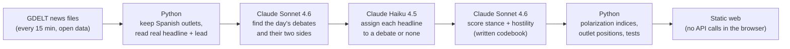

# PolarMap

**An LLM pipeline that reads a day of Spanish news, finds what the press is arguing about, and measures where each outlet stands and how hostile the coverage is.**

**Live demo → [luciagarciamorenog.github.io/polarmap](https://luciagarciamorenog.github.io/polarmap/)** · Portfolio: [luciagarciamorenog.netlify.app](https://luciagarciamorenog.netlify.app)

---

## Why it exists

Polarization worries me, and I believe that informing people about it is one of the first steps to changing the trend. You can't inform people about something you can't see, so PolarMap makes it measurable. Every day it shows which debates divide the Spanish press, which side each outlet leans to, and whether coverage stays a disagreement or turns into hostility toward the other side.

## What it found (latest run: 24 Nov 2026)

In 24 hours PolarMap read **5,931 headlines** from Spanish outlets. The model found **5 debates**, and **1,323 headlines** (22%) were scored inside one of them. Three quarters of the day's news belongs to no debate at all, because most news is not a fight.

| Debate (defined by the model) | Headlines | Outlets | Ideological | Affective | Does the outlet predict the stance? |
|---|---|---|---|---|---|
| Keep or change the government | 909 | 62 | 0.41 | 0.32 | **Yes.** Outlet explains 23% (7% by chance, p < 0.001) |
| Housing | 156 | 21 | 0.28 | 0.04 | Not beyond chance today (p = 0.71) |
| Migration policy | 115 | 15 | 0.25 | 0.14 | **Yes.** 43% (18% by chance, p < 0.001) |
| Justice and judicial independence | 93 | 14 | 0.22 | 0.30 | Not beyond chance today (p = 0.63) |
| Amnesty and Catalonia | 50 | 5 | 0.34 | 0.31 | Indicative only (5 outlets) |

How to read the table:

- **The government debate is both split and hostile.** Five days before the 29 November general election, outlets form camps well beyond chance (distance between outlet camps 0.42 vs 0.31 by chance, p = 0.015). About a third of their headlines use attacking language.
- **Housing is disagreement without hostility** (affective 0.04): the press argues about policy, not about the other side.
- **Outlets also differ in *what* they cover.** Agendas differ beyond chance (Jensen–Shannon distance 0.32 vs 0.27, p = 0.001). For example, Catalan outlets covered the amnesty 6–8× more than the average outlet.

The [live demo](https://luciagarciamorenog.github.io/polarmap/) shows every debate, the position of every outlet with its uncertainty, example headlines from each side, and each outlet's daily evolution.

## Architecture



| Step | What happens | Where |
|---|---|---|
| 1. Collect | Downloads [GDELT](https://www.gdeltproject.org/) Global Knowledge Graph files (main + translated series) for 24 hours and keeps articles from Spanish media domains | `ingest/gkg_files.py` |
| 2. Clean | Drops soft sections (sport, horoscopes…) and syndicated copies, reads each article's real headline and lead, and **skips publishers that reserve text-and-data-mining rights** | `ingest/leads.py`, `analysis/discover.py` |
| 3. Discover debates | Claude reads the day's headlines and proposes the debates, each with two opposing positions. A fixed catalogue (`data/temas.json`) keeps recurring debates under the same name and sides, so days can be compared | `analysis/discover.py` |
| 4. Assign | Claude Haiku assigns every headline to one debate or to none | `analysis/discover.py` |
| 5. Score | Claude Sonnet scores each headline in a debate by following a written [codebook](validate/CODEBOOK.md): stance (−1 … +1), hostility, "us vs them". It writes a short reason before each score | `analysis/discover.py` |
| 6. Measure | Polarization indices per debate, outlet positions with bootstrap intervals and permutation tests, plus a media-ecosystem report (camps of outlets, agendas, government ↔ opposition axis) | `analysis/metrics.py`, `analysis/outlets.py`, `analysis/ecosystem.py` |
| 7. Publish | Builds a self-contained web page from the run | `web/build_data.py` |

All model calls go through the Anthropic **Batch API** (half price). Model output is parsed defensively: malformed JSON is retried and is never read as "no debate".

## How polarization is defined and scored

1. **Stance, not sentiment.** A headline about an earthquake is very negative and not divisive at all. PolarMap measures *which side* a headline takes on a defined debate, not its tone.
2. **Disagreement is not polarization.** Opinions spread evenly across a scale show diversity, not polarization. Polarization means clustering into separate camps. That is why the ideological index is **Esteban-Ray**, which rewards separated groups, and not variance.
3. **Ideological ≠ affective.** Two camps that disagree politely are not the same as two camps that attack each other. **Affective polarization** counts hostility concentrated at the extremes and aimed at the other side, not generic negativity.
4. **Debates are discovered, not predefined.** The model decides what is being argued about each day. Both sides of every debate are stored (`data/internal/axes.json`), so every editorial choice the model makes can be audited.
5. **Outlets, not single headlines.** A single headline mostly informs. Even partisan outlets publish wire copy and quotes from both sides. Positions are therefore reported per outlet, with uncertainty, and tested against chance (stances shuffled across the same outlets).
6. **Grey beats a wrong colour.** A debate only gets a verdict if it has enough headlines, enough outlets and no outlet dominating the volume. Otherwise it is marked as limited data.
7. **No outlet is labelled left or right.** An outlet's position comes only from what it publishes.

## Evaluation

| What the model does | Result | Verdict |
|---|---|---|
| Assign a headline to the right debate (or none) | **95–97% agreement**, Cohen's κ 0.93–0.95 (vs 29 human-labelled headlines and a 150-headline reference set) | Reliable |
| Stance of an outlet (mean of its headlines) | Outlet order replicates across two unrelated debates two months apart: **Spearman ρ = 0.89** (12 outlets, p < 0.001) | Consistent |
| Hostility of the language | Spearman ρ ≈ 0.62 against labels | Usable |
| Stance of a *single* headline | ρ 0.33–0.46. The model puts more headlines at the centre than humans do | Weak, which is why results are reported per outlet |

The labelled sets come from an earlier run (25 Sep 2026). The 150-headline reference set was labelled by a stronger model following the same codebook, so it is not independent of the model being evaluated. The human set is small. Re-evaluating the current codebook on the daily runs is on the roadmap.


## Cost

| Run | Headlines | Cost | Per 1,000 headlines |
|---|---|---|---|
| 24 Nov 2026 (current pipeline) | 5,931 | **$2.34** | $0.39 |

Breakdown of the latest run: finding debates $0.07 (Sonnet), assigning headlines $0.53 (Haiku), scoring stance and hostility $1.74 (Sonnet). Scoring dominates because the model writes a short reason before each score. Earlier versions skipped that step and read half the GDELT files, and cost $0.43–0.56 per run. A daily run costs about **$70 a month**. All figures are measured from real token usage (`data/internal/*_usage.json`), not estimated.

## Run it

```bash
pip install -r requirements.txt
export ANTHROPIC_API_KEY=...        # or copy .env.example to .env (git-ignored)

# tests (no network, no API key)
python3 analysis/test_metrics.py && python3 analysis/test_outlets.py && python3 analysis/test_discover.py

# count Spain's headlines without calling the API (free)
python3 pipeline_discover.py --countries ES --hours 24 --dry-run

# full daily run (40-60 min, ~$2.3) and web rebuild
./diario.sh                          # = pipeline_discover.py + web/build_data.py

# rebuild the web page from saved runs (no API)
python3 web/build_data.py            # writes web/index.html
```

To publish any change (code, prompts, web or README), `./publicar.sh "what changed"` runs the tests, rebuilds the web, checks that no key is included and pushes to GitHub; Netlify then deploys the live demo. Workflow in Spanish: [`docs/COMO_CAMBIAR_POLARMAP.md`](docs/COMO_CAMBIAR_POLARMAP.md).

To see the output without running anything, open [`examples/ES_2026-11-24.json`](examples/ES_2026-11-24.json) (trimmed real run, with a [field guide](examples/README.md)) or `web/index.html`.

## Roadmap

1. **Daily runs** (started 24 Nov 2026) so each outlet's position and hostility can be followed over time.
2. **Other European countries and languages**, for a comparable measure of polarization across Europe. Then validate country scores against [V-Dem](https://www.v-dem.net/) (`validate/ground_truth.py`).
3. **Benchmark models**, including open-weight ones, on accuracy and cost for the scoring step, against the same labelled sets.
4. **A bigger human-labelled set** (100+ headlines, two annotators to measure the human ceiling), and re-evaluation of the current codebook.
5. **A Q&A agent (RAG)** on top of the interface, grounded in PolarMap's data and in conflict research such as Amanda Ripley's *High Conflict*. It would help people understand where polarization comes from and how to navigate it.

## Repository map

```
ingest/      GDELT files, real headlines and leads
analysis/    debate discovery, scoring, polarization metrics, outlet positions, media ecosystem
validate/    codebook, labelling tool, scoring against labels, pilot of an alternative method
web/         static interface: build script, template, generated index.html and the About page (deployed on Netlify)
data/        run snapshots, usage and logs, fixed debate catalogue, labels
examples/    a small, readable sample of one run's output
docs/        figures, data contract, social layer (experimental), original methodology notes
legacy/      earlier generations of the pipeline, kept for reference
```

## How it was built

I designed the product and the methodology: what to measure, how to measure it, which checks a number has to pass before it is shown, and how to validate it. The code was written with AI coding assistants (Claude and Cursor), and I reviewed, ran and tested every step. The project is as much about using AI to *build* as about using AI to *measure*.

## Data and ethics

- Source: the open [GDELT Project](https://www.gdeltproject.org/). An outlet counts as Spanish if its domain ends in .es, .cat, .eus or .gal, or if it is on an explicit list of Spanish .com outlets. Coverage per outlet depends on what GDELT collects.
- Publishers that reserve their rights to text and data mining are excluded (631 articles on 24 Nov).
- Article leads are used for analysis only and are not committed to this repository. The web shows headlines with a link to the original article.
- API keys are read from environment variables only. `.env` is git-ignored and has never been committed.
- It measures published media, not public opinion.

An experimental social-media layer (Bluesky, YouTube) is described in [`docs/social_layer.md`](docs/social_layer.md).

— Lucía García-Moreno · [LinkedIn](https://linkedin.com/in/luciagmg)
